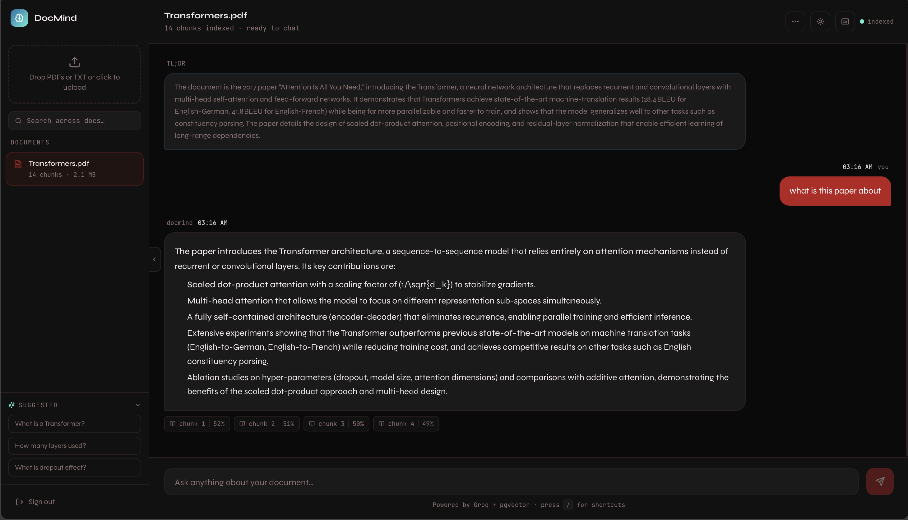

# DocMind — AI Document Q&A

> Upload any PDF. Ask anything. Get answers grounded in your document — not hallucinations.



## What it does

DocMind is a full-stack RAG (Retrieval-Augmented Generation) application that lets you chat with your documents using AI. Upload a PDF, ask questions in natural language, and get accurate, cited answers streamed in real time — powered by BGE vector embeddings and gpt-oss-20b on Groq.

---

## Features

### Core
- **Semantic search** — pgvector cosine similarity finds relevant content even with different phrasing
- **Streaming responses** — answers stream token by token via gpt-oss-20b on Groq
- **Multi-document chat** — query across multiple PDFs simultaneously with a single question
- **Per-chunk similarity scores** — shown on every source chunk as plain similarity, not a correctness guarantee (see [Retrieval Evaluation](#retrieval-evaluation))
- **Source citations** — every answer shows which chunks it was grounded in
- **Measured retrieval quality** — an evaluation harness benchmarks chunking and embedding choices with Hit@k and MRR (see [Retrieval Evaluation](#retrieval-evaluation))

### Productivity
- **Smart suggestions** — AI-generated questions, generated once per document and stored, so switching documents is instant
- **Document summarization** — TL;DR generated once per document, stored, and shown instantly above the chat afterwards
- **Chat search** — Ctrl+F style search through current chat history
- **Pin messages** — star/bookmark key AI answers to reference later
- **Export chat as PDF** — download full Q&A session as a formatted report
- **Rename documents** — inline rename in the sidebar
- **Document tags** — color-coded labels to organize docs; filter sidebar by tag
- **Cross-document search** — semantic search across all indexed documents from the sidebar
- **Quick actions** — "Explain simpler" / "More detail" buttons on every response
- **Regenerate** — one-click regenerate on any assistant message

### UX & Polish
- **Resizable sidebar** — drag to resize, collapses to zero, persists across sessions
- **Mobile responsive** — full slide-in sidebar overlay on mobile
- **Framer Motion animations** — messages slide in, sidebar animates, thinking bubble waves
- **Dark/light mode** — persisted across sessions with smooth CSS variable transition
- **Keyboard shortcuts** — press `/` for full shortcuts panel
- **Message timestamps** — shown on hover, pulled from real DB timestamps
- **Upload progress** — animated checklist showing each indexing step
- **Drag-and-drop upload** — drop up to 10 files at once for parallel indexing
- **Tag manager portal** — tag assignment popup rendered via React portal, no overflow clipping
- **Dashboard highlight** — clicking a recent question navigates and highlights that message
- **Usage dashboard** — charts showing documents, messages, chunks, daily activity, storage

### Auth & Security
- **JWT authentication** — secure per-user document isolation
- **Per-user document storage** — your documents are private and only accessible to you

---

## Tech Stack

| Layer | Technology |
|-------|-----------|
| Frontend | React 18, Tailwind CSS, Framer Motion, Zustand |
| Backend | FastAPI, Python 3.11 |
| AI / LLM | `openai/gpt-oss-20b` (answers) and `openai/gpt-oss-120b` (summaries, suggestions) via Groq API (free tier) |
| Embeddings | sentence-transformers `BAAI/bge-small-en-v1.5` (384-dim) |
| Vector DB | PostgreSQL + pgvector |
| Auth | JWT (python-jose + bcrypt) |
| Containerization | Docker + docker-compose |

The answer model is set by `GEN_MODEL`, the summary and suggestion model by `BACKGROUND_MODEL`, and the embedding model by `MODEL_NAME`, all at the top of `backend/app/rag/pipeline.py`. Hosted model catalogs change, so check Groq's current model list if the API returns `model_not_found`.

---

## Architecture

```
User uploads PDF
      ↓
Text Extraction (PyMuPDF)
      ↓
Chunking (500 words, 50-word overlap)
      ↓
Embeddings (BGE-small, 384-dim)
      ↓
Vector Store (pgvector)
      ↓
User asks question
      ↓
Query Embedding (BGE query prefix) → Exact Cosine Similarity Search (per document) → Top-4 chunks + similarity scores
      ↓
Prompt construction + gpt-oss-20b (Groq) → Streaming SSE
      ↓
React frontend renders token by token with blinking cursor + similarity badges
```

---

## Retrieval Evaluation

Retrieval settings were chosen with an evaluation harness (`backend/rag_eval/`) instead of by guesswork.

### How it works

- **Corpus:** five ML papers (ResNet, Attention Is All You Need, BERT, RAG, AlexNet).
- **Test set:** an LLM reads sampled 200-word passages and writes one question per passage plus the verbatim sentence that answers it. Each sentence is verified against the source text. 75 questions were generated (15 per paper) and 42 were kept after manual review. Papers' bibliography questions, trivia from example text, duplicated facts and context-dependent questions were removed.
- **Ground truth as word offsets:** the answer location is stored as word positions in the document, not chunk IDs, so one test set can score any chunk size or overlap.
- **Metrics:** Hit@k (is a relevant chunk in the top k?) and MRR (how high does the first relevant chunk rank?). A chunk counts as relevant if it covers at least half of the answer sentence. DocMind retrieves k = 4.
- **Search:** exact cosine search in memory, one document at a time, matching DocMind's single-document chat.

### Results (42 questions, sorted by MRR)

| Model | Chunk | Overlap | Chunks | Hit@1 | Hit@4 | Hit@8 | MRR |
|---|---|---|---|---|---|---|---|
| BAAI/bge-small-en-v1.5 | 500 | 50 | 94 | 0.619 | 0.857 | 0.929 | 0.724 |
| all-MiniLM-L6-v2 | 100 | 10 | 463 | 0.476 | 0.881 | 0.976 | 0.667 |
| all-MiniLM-L6-v2 | 200 | 20 | 233 | 0.524 | 0.786 | 0.881 | 0.664 |
| BAAI/bge-small-en-v1.5 | 200 | 20 | 233 | 0.476 | 0.833 | 0.952 | 0.654 |
| BAAI/bge-small-en-v1.5 | 300 | 30 | 156 | 0.476 | 0.857 | 0.929 | 0.650 |
| all-MiniLM-L6-v2 | 500 | 100 | 105 | 0.548 | 0.762 | 0.857 | 0.649 |
| all-mpnet-base-v2 | 500 | 50 | 94 | 0.500 | 0.738 | 0.857 | 0.627 |
| all-MiniLM-L6-v2 | 300 | 30 | 156 | 0.476 | 0.786 | 0.833 | 0.626 |
| all-MiniLM-L6-v2 | 500 | 50 | 94 | 0.405 | 0.714 | 0.762 | 0.572 |
| all-MiniLM-L6-v2 | 500 | 0 | 86 | 0.381 | 0.667 | 0.738 | 0.539 |
| all-mpnet-base-v2 | 300 | 30 | 156 | 0.357 | 0.667 | 0.857 | 0.532 |
| all-mpnet-base-v2 | 200 | 20 | 233 | 0.357 | 0.619 | 0.810 | 0.510 |

The original DocMind setup (MiniLM, 500/50) scored Hit@4 0.714 and MRR 0.572. DocMind now runs BGE-small at the same 500/50 chunking.

### Findings

- **Switching the embedding model gave the best overall result.** At identical chunking, BGE-small raised Hit@4 from 0.714 to 0.857, Hit@1 from 0.405 to 0.619 and MRR from 0.572 to 0.724. Both models output 384 dimensions, so no schema change was needed.
- **Likely cause:** `all-MiniLM-L6-v2` reads at most 256 tokens of input (roughly 200 words), so most of a 500-word chunk never reaches its embedding. BGE-small reads 512 tokens. MiniLM improving as chunks shrink fits this explanation, though the harness doesn't isolate it.
- **Overlap helped.** For MiniLM at 500 words, MRR rose from 0.539 to 0.572 to 0.649 as overlap went from 0 to 50 to 100 words. Overlap was not tested with BGE.
- **Hit@k is not directly comparable across chunk sizes.** Four 100-word chunks give the LLM 400 words of context, four 500-word chunks give it 2,000, and a hit only means the answer sentence was retrieved. Compare models at the same chunk size.
- **mpnet was not worth its cost.** It is larger, slower and 768-dim, and it scored below MiniLM at 200 and 300 words.
- **Similarity scores are only a weak signal of correctness.** Chunks that held the answer had a median score of 74% against 69% for those that did not (AUC 0.64), and no score band was reliably correct: even at 80% and above, 45% of chunks held the answer. The UI therefore shows plain similarity instead of colour-coded confidence. Details are in `rag_eval/calibration.md`.

### Limitations

- 42 questions from five ML papers: differences under about five points are within noise, and results may not transfer to other document types.
- Questions are LLM-written, which tends to flatter every configuration. Mean question-to-answer word overlap was 0.31.
- This measures retrieval only, not answer quality.

### Run it yourself

```bash
cd backend && source venv/bin/activate
mkdir -p rag_eval/pdfs                     # put 4-8 PDFs here
python -m rag_eval.build_testset --per-doc 15
# review rag_eval/testset.jsonl and delete weak or ambiguous questions
python -m rag_eval.run_eval                # writes rag_eval/results.md and results.json
python -m rag_eval.score_calibration       # how scores relate to correctness; writes calibration.md
```

`build_testset` calls Groq to write questions. Set `EVAL_GEN_MODEL` or pass `--model` to choose a model.

---

## Retrieval design notes

**No approximate vector index.** An earlier version used an `ivfflat` index (`lists = 100`) created on an empty table. For small collections it returned no rows at all, because the `doc_id` filter is applied after the approximate scan and the default search probes a single cluster. DocMind always searches within a document or a user's own documents, so it now uses a plain btree index on `chunks.doc_id` and sorts by exact cosine distance. That is fast and complete at this scale. If collections grow large, an HNSW index (which needs no training step) is the next option, with filtering behaviour tested first.

**Upgrading an existing local database.** A database created by an earlier version holds MiniLM vectors and an `ivfflat` index. Run these once from `backend/`, then restart the server:

```bash
python -c "from app.db import get_db_connection as g; c=g(); k=c.cursor(); k.execute('DROP INDEX IF EXISTS chunks_embedding_idx'); c.commit()"
python -m reindex_chunks
```

A fresh database needs neither step.

**Rate limits shape the design.** Groq's free plan allows 8,000 tokens per minute for each model, and the first version of the summary request alone used 4,000 to 5,000 of them by sending six full chunks. When the budget ran short, the SDK silently waited out the retry-after (one stall measured 53 seconds). Now a summary reads only the opening ~1,200 words and the suggestions read only the first chunk, about 3K tokens together. Those two jobs run one at a time on a different model from chat answers, so they never compete with an answer, and they fail fast so the UI can offer a retry. Both results are stored per document, so the cost is paid once, and `python -m rag_eval.warm_cache` pre-generates them for every document at a pace the limit allows.

**Changing the embedding model requires re-embedding.** Vectors from different models live in different spaces, even at the same dimension. After changing `MODEL_NAME`, run `python -m reindex_chunks` from `backend/`. It re-embeds every stored chunk from its saved text, so the original PDFs are not needed.

---

## Quick Start

### Prerequisites
- Python 3.11+
- Node.js 18+
- Docker Desktop

### 1. Clone and configure

```bash
git clone https://github.com/priyansh-0304/docmind
cd docmind
cp backend/.env.example backend/.env
# Edit backend/.env — add your GROQ_API_KEY from console.groq.com (free)
```

### 2. Start the database

```bash
docker-compose up db -d
```

### 3. Run the backend

```bash
cd backend
python3.11 -m venv venv
source venv/bin/activate        # Windows: venv\Scripts\activate
pip install -r requirements.txt
uvicorn app.main:app --reload
```

API docs available at **http://localhost:8000/docs**

> When running the backend directly on your machine, `DATABASE_URL` must point at `localhost`. The hostname `db` only resolves inside Docker's network.

### 4. Run the frontend

```bash
cd frontend
npm install
npm run dev
```

Open **http://localhost:5173**

### Daily workflow

```bash
# Terminal 1 — DB (run once, stays running)
docker-compose up db -d

# Terminal 2 — Backend
cd backend && source venv/bin/activate && uvicorn app.main:app --reload

# Terminal 3 — Frontend
cd frontend && npm run dev
```

---

## Project Structure

```
docmind/
├── docker-compose.yml
├── README.md
│
├── backend/
│   ├── .env.example
│   ├── requirements.txt
│   ├── Dockerfile
│   ├── reindex_chunks.py            # Re-embed stored chunks after changing the embedding model
│   ├── rag_eval/
│   │   ├── build_testset.py         # LLM-written questions + verbatim-evidence ground truth
│   │   ├── run_eval.py              # Compare chunk sizes, overlaps and embedding models
│   │   ├── score_calibration.py     # How similarity scores relate to correctness
│   │   ├── ask_debug.py             # Show retrieval and the model's answer for one question
│   │   ├── warm_cache.py            # Pre-generate stored summaries and suggestions
│   │   ├── common.py                # Offset-aware chunker, PDF loading, shared paths
│   │   ├── pdfs/                    # Evaluation corpus
│   │   ├── testset.jsonl            # Reviewed question set
│   │   ├── results.md               # Latest evaluation results
│   │   └── calibration.md           # Score vs. correctness report
│   └── app/
│       ├── main.py                  # FastAPI app, CORS, startup
│       ├── config.py                # Settings from .env
│       ├── db.py                    # DB connection + table init (users, documents,
│       │                            #   chunks, chat_messages, tags, document_tags)
│       │                            # btree index on chunks.doc_id (no ANN index)
│       ├── models/
│       │   └── schemas.py           # Pydantic request/response models
│       ├── auth/
│       │   └── utils.py             # JWT creation, bcrypt, get_current_user
│       ├── rag/
│       │   └── pipeline.py          # Extract → chunk → embed → retrieve → generate
│       │                            # MODEL_NAME / GEN_MODEL configured at top
│       │                            # embed_query adds the BGE query prefix
│       │                            # retrieve_chunks returns (text, similarity_score)
│       │                            # generate_answer_stream yields tokens
│       │                            # generate_summary_stream for doc summaries
│       └── routers/
│           ├── auth.py              # POST /auth/register, /auth/login
│           ├── documents.py         # /docs/* (upload, list, rename, tags, summary, search)
│           └── chat.py              # /chat/* (stream, multi, suggest, history, activity, stats)
│
└── frontend/
    └── src/
        ├── App.jsx                  # Routes: / /login /app /dashboard
        ├── main.jsx                 # Entry + Toaster
        ├── index.css                # Tailwind + CSS variables for dark/light theme
        ├── lib/
        │   └── api.js               # Axios + JWT interceptor + auto-logout on 401
        ├── store/
        │   └── useStore.js          # Zustand: theme, auth, documents, tags, chat
        ├── pages/
        │   ├── LandingPage.jsx      # Marketing landing page with animated demo chat
        │   ├── AuthPage.jsx         # Login / Register
        │   ├── AppPage.jsx          # Main chat interface + keyboard shortcuts
        │   └── DashboardPage.jsx    # Usage analytics with recharts
        └── components/
            ├── ui/
            │   ├── ProtectedRoute.jsx
            │   └── KeyboardShortcuts.jsx  # / to toggle, all shortcuts listed
            ├── documents/
            │   └── Sidebar.jsx      # Resizable, collapsible, mobile overlay
            │                        # Doc list, upload, tags, search, suggestions
            └── chat/
                ├── ChatMessage.jsx  # Markdown, copy, retry, similarity badges,
                │                    #   pin, simpler/detail actions, timestamps
                ├── ChatInput.jsx    # Auto-resize textarea, shake on empty
                └── ExportButton.jsx # jsPDF export with markdown stripping
```

---

## Database Schema

```sql
users          (id, email, hashed_password, created_at)
documents      (id, user_id, filename, file_size, chunk_count, summary, suggestions, created_at)
chunks         (id, doc_id, chunk_index, text, embedding vector(384), created_at)
               -- btree index on doc_id
chat_messages  (id, user_id, doc_id, role, content, created_at)
tags           (id, user_id, name, color, created_at)
document_tags  (doc_id, tag_id)  -- junction table
```

---

## API Endpoints

| Method | Endpoint | Description |
|--------|----------|-------------|
| POST | `/auth/register` | Create account |
| POST | `/auth/login` | Get JWT token |
| POST | `/docs/upload` | Upload + index document |
| GET | `/docs/` | List user's documents (with tags) |
| PATCH | `/docs/{id}/rename` | Rename document |
| DELETE | `/docs/{id}` | Delete document |
| GET | `/docs/{id}/summary` | Stream document summary (SSE) |
| GET | `/docs/search?q=` | Semantic search across all docs |
| GET | `/docs/tags` | List user's tags |
| POST | `/docs/tags` | Create tag |
| DELETE | `/docs/tags/{id}` | Delete tag (removes from all docs) |
| POST | `/docs/{id}/tags` | Assign tag to document |
| DELETE | `/docs/{id}/tags/{tag_id}` | Remove tag from document |
| POST | `/chat/stream` | Stream Q&A response — single doc (SSE) |
| POST | `/chat/stream/multi` | Stream Q&A across multiple docs (SSE) |
| POST | `/chat/suggest` | Generate suggested questions (no history saved) |
| GET | `/chat/history/{doc_id}` | Get chat history with timestamps |
| GET | `/chat/activity` | Daily question counts — last 7 days |
| GET | `/chat/stats` | Aggregate stats (avg response length etc.) |

---

## Keyboard Shortcuts

| Shortcut | Action |
|----------|--------|
| `/` | Open shortcuts panel |
| `⌘K` | Focus chat input |
| `⌘L` | Toggle dark/light mode |
| `⌘D` | Go to dashboard |
| `⌘B` | Toggle sidebar collapse |
| `⌘Shift+C` | Clear chat |
| `⌘E` | Export chat as PDF |
| `Esc` | Close panel |

---

## Environment Variables

```env
GROQ_API_KEY=your_groq_key          # from console.groq.com (free)
DATABASE_URL=postgresql://...        # postgres connection string
SECRET_KEY=your_jwt_secret           # any random string, keep it secret
ALGORITHM=HS256
ACCESS_TOKEN_EXPIRE_MINUTES=1440
```

---

## Resume Bullets

- Built a full-stack RAG pipeline ingesting PDFs via overlapping chunking and BGE embeddings stored in pgvector, with cosine similarity retrieval and per-chunk similarity scores
- Implemented real-time streaming responses using Server-Sent Events with FastAPI and gpt-oss-20b via the Groq API
- Built a retrieval evaluation harness (LLM-generated questions with verbatim-evidence ground truth) benchmarking 12 chunking and embedding configurations; switching embedding models raised Hit@4 from 71% to 86% and MRR from 0.57 to 0.72
- Diagnosed a silent retrieval failure where an approximate ivfflat index returned zero results on small collections; replaced it with exact, document-filtered search
- Engineered cross-document semantic search enabling simultaneous RAG queries across multiple indexed PDFs
- Grounded all LLM responses in retrieved document context with source citations and similarity scores
- Built full authentication system with JWT, bcrypt, and per-user document isolation in PostgreSQL
- Packaged the backend with Docker and ran PostgreSQL with pgvector through docker-compose for one-command local setup

---

## Possible Future Features

- [ ] Answer-quality evaluation (LLM-as-judge) on top of the retrieval metrics
- [ ] HNSW index if collections outgrow exact search
- [ ] Real-time collaborative chat — multiple users on the same document
- [ ] Document version history — track changes across re-uploads
- [ ] Public share link — read-only shareable URL for a chat session
- [ ] Highlight source chunk in PDF viewer — show exact page/location
- [ ] Multi-turn memory summary — compress old context automatically
- [ ] Rate limiting per user — prevent API abuse in production
- [ ] Response caching — return cached answers for repeated questions
- [ ] Webhook notifications — alert when a long document finishes indexing
- [ ] CSV/Excel support — index spreadsheet data as searchable chunks
- [ ] OAuth login — Google / GitHub sign-in

---

## License

MIT — feel free to use this as a portfolio project or starting point.

---

*Built by Priyansh Arora*